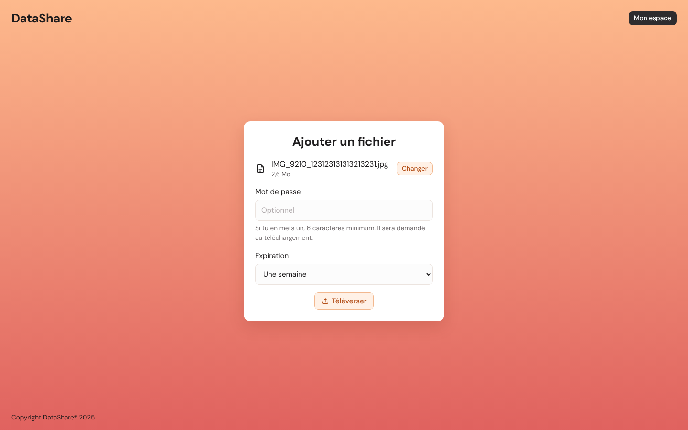

# DataShare

Prototype d'une plateforme de transfert de fichiers pour les freelances et les petites entreprises : on téléverse un fichier, on obtient un lien de téléchargement temporaire, et on retrouve ses envois dans un espace personnel.

| | |
|---|---|
| Front | Angular 22 (TypeScript strict) |
| API | Spring Boot 4.1, Java 21 |
| Base de données | PostgreSQL 16 |
| Stockage des fichiers | Disque local (interface prévue pour S3) |



## Fonctionnalités

Le périmètre est celui du MVP décrit dans les spécifications.

- **US01 Téléversement** : fichier jusqu'à 1 Go, mot de passe optionnel, expiration de 1 à 7 jours, extensions dangereuses refusées.
- **US02 Téléchargement par lien** : page publique avec nom, taille et date d'expiration, mot de passe demandé si le fichier est protégé, message clair si le lien est expiré ou inconnu.
- **US03 Création de compte** et **US04 Connexion** : e-mail unique, mot de passe haché avec BCrypt, authentification par jeton JWT.
- **US05 Historique** : liste des fichiers envoyés, filtres « Tous / Actifs / Expiré ».
- **US06 Suppression** : suppression définitive après confirmation.

En complément : purge automatique des fichiers expirés chaque nuit (règle de gestion de US01).

## Démarrage rapide

### Prérequis

- Java 21 et Maven 3.9 (ou plus récents)
- Node.js 22 et npm 10
- PostgreSQL 16, installé localement ou lancé avec Docker
- Google Chrome, uniquement pour les tests de bout en bout

### 1. Créer la base de données

Avec Docker :

```bash
docker compose up -d
```

Ou avec un PostgreSQL installé sur le poste :

```bash
# Linux / macOS (compte administrateur postgres)
PSQL="sudo -u postgres psql" ./database/setup.sh

# Windows (PowerShell, dans le dossier du projet)
.\database\setup.ps1
```

Le script crée le rôle `datashare` et la base `datashare`. Les tables sont créées automatiquement par Flyway au premier démarrage de l'API.

### 2. Lancer l'API

```bash
cd backend
mvn spring-boot:run
```

L'API écoute sur http://localhost:8080. La documentation interactive des endpoints (Swagger) est sur http://localhost:8080/api/docs/ui.

### 3. Lancer le front

```bash
cd frontend
npm install
npm start
```

L'application est sur http://localhost:4200. En développement, les appels à `/api` sont redirigés vers l'API par `proxy.conf.json` : pas de configuration CORS à faire.

### 4. Essayer

1. Crée un compte sur http://localhost:4200/inscription.
2. Clique sur le bouton rond de l'accueil et choisis un fichier.
3. Ajoute éventuellement un mot de passe, choisis une durée, puis clique sur **Téléverser**.
4. Copie le lien et ouvre-le dans une fenêtre de navigation privée pour voir ce que voit le destinataire.
5. Retrouve le fichier dans **Mon espace**, où tu peux le supprimer.

## Configuration

L'API se configure par variables d'environnement. Les valeurs par défaut conviennent au développement local.

| Variable | Défaut | Rôle |
|---|---|---|
| `DB_URL` | `jdbc:postgresql://localhost:5432/datashare` | Base PostgreSQL |
| `DB_USER` / `DB_PASSWORD` | `datashare` / `datashare` | Compte applicatif |
| `JWT_SECRET` | secret de développement | Clé de signature des jetons, en Base64, 32 octets minimum. **À changer en production.** |
| `STORAGE_DIR` | `./storage` | Dossier où sont écrits les fichiers |
| `PUBLIC_URL` | `http://localhost:4200` | Adresse du front, utilisée pour construire les liens de téléchargement |
| `CORS_ORIGINS` | `http://localhost:4200` | Origines autorisées à appeler l'API |
| `PORT` | `8080` | Port HTTP de l'API |

Générer un secret JWT : `openssl rand -base64 48`.

Les autres réglages (extensions interdites, heure de la purge, durée de conservation de l'historique) sont dans `backend/src/main/resources/application.yml`.

## Tests

```bash
cd backend && mvn verify          # 34 tests unitaires et d'intégration, couverture contrôlée (70 % minimum)
cd frontend && npm run test:ci    # 37 tests unitaires, rapport de couverture dans frontend/coverage
cd frontend && npm run e2e        # 5 scénarios Playwright, sur ordinateur et mobile (API et front lancés)
```

Le détail est dans [TESTING.md](TESTING.md).

## Mise en production (build)

```bash
cd backend && mvn -DskipTests package        # → backend/target/datashare-api-0.1.0.jar
cd frontend && npm run build                  # → frontend/dist/frontend/browser (fichiers statiques)
```

Le front est un ensemble de fichiers statiques à servir par un serveur web (Nginx, par exemple), qui redirige aussi `/api` vers l'API. L'API se lance avec `java -jar datashare-api-0.1.0.jar` et les variables ci-dessus.

## Organisation du dépôt

```
backend/      API Spring Boot (code, tests, migrations Flyway)
frontend/     Application Angular (code, tests unitaires, tests Playwright dans e2e/)
database/     Scripts d'installation de la base PostgreSQL
perf/         Test de charge
docs/         Architecture, contrat OpenAPI, journal de l'IA, captures
.github/      Intégration continue et mises à jour automatiques des dépendances
```

## Documentation

- [Architecture, modèle de données et endpoints](docs/architecture.md)
- [Contrat OpenAPI](docs/openapi.json)
- [Plan de tests](TESTING.md)
- [Sécurité](SECURITY.md)
- [Performance](PERF.md)
- [Maintenance](MAINTENANCE.md)
- [Journal de l'utilisation de l'IA](docs/journal-ia.md)

## Conventions

Les commits suivent la norme [Conventional Commits](https://www.conventionalcommits.org/fr/) : `feat:`, `fix:`, `test:`, `docs:`, `chore:`…
