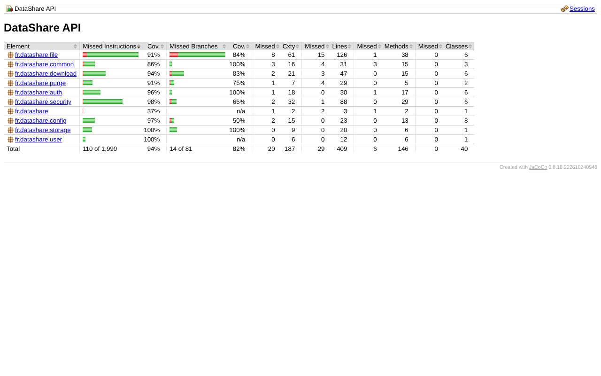
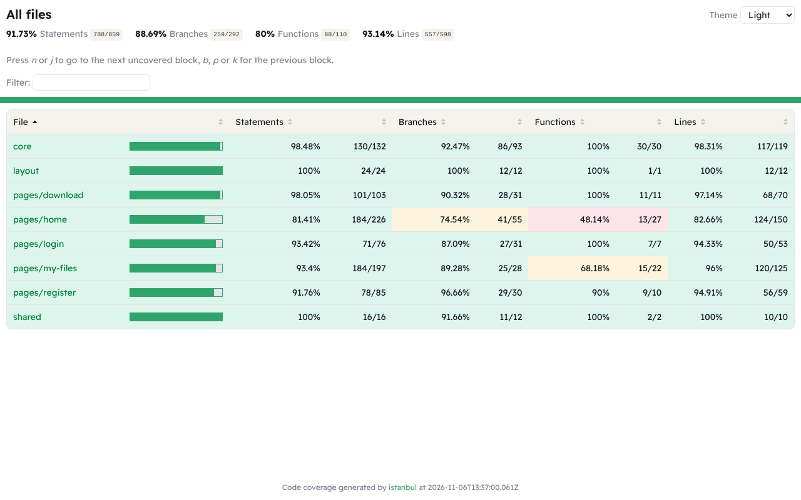

# Plan de tests

## Stratégie

Les tests sont répartis sur trois niveaux. Chaque niveau vérifie ce que les autres ne peuvent pas voir.

| Niveau | Outil | Ce qui est vérifié | Nombre |
|---|---|---|---|
| Unitaires API | JUnit 5, AssertJ | Règles isolées : contrôles de saisie, nettoyage des noms de fichiers, stockage | 13 |
| Intégration API | Spring Boot Test, MockMvc, H2 (mode PostgreSQL) | Chaque user story de bout en bout côté serveur : HTTP, sécurité, base, disque | 21 |
| Unitaires front | Vitest (via `ng test`), jsdom | Composants, services, intercepteur, gardes, fonctions de formatage | 37 |
| Bout en bout | Playwright, Chrome | Parcours réels dans un navigateur, sur écran d'ordinateur et de mobile | 5 scénarios × 2 écrans |

Les tests d'intégration utilisent une horloge de test que l'on peut avancer (`MutableClock`) : on vérifie l'expiration d'un lien sans attendre une journée.

## Lancer les tests

### API

```bash
cd backend
mvn verify
```

`verify` exécute tous les tests puis contrôle la couverture : **le build échoue si moins de 70 % des lignes sont couvertes**. Le rapport HTML est dans `backend/target/site/jacoco/index.html`. Aucune base PostgreSQL n'est nécessaire (H2 en mémoire).

### Front

```bash
cd frontend
npm run test:ci
```

Même principe : seuil de 70 % configuré dans `angular.json`, rapport dans `frontend/coverage/frontend/index.html`.

### Bout en bout

Prérequis : PostgreSQL, l'API (`mvn spring-boot:run`) et le front (`npm start`) lancés.

```bash
cd frontend
npm run e2e            # utilise le Chrome installé sur le poste
npm run e2e:report     # ouvre le rapport HTML
```

Pour utiliser le Chromium de Playwright plutôt que Chrome : `npx playwright install chromium` puis `E2E_CHANNEL=chromium npm run e2e`.

En intégration continue (GitHub Actions), les trois niveaux tournent à chaque push : voir `.github/workflows/ci.yml`.

## Couverture obtenue

| Partie | Lignes | Branches | Objectif |
|---|---|---|---|
| API | **93 %** | voir rapport | 70 % |
| Front | **93 %** | 89 % | 70 % |





## Fonctionnalités couvertes et critères d'acceptation

Chaque critère vient des règles de gestion et contrôles de saisie des spécifications.

### US01 Téléversement

| Critère d'acceptation | Test |
|---|---|
| Un utilisateur connecté téléverse un fichier et obtient un lien unique | `FileFlowIT.upload_returns_unique_link_and_expiration`, e2e `upload-and-share` |
| Deux envois n'ont jamais le même lien | `FileFlowIT.two_uploads_never_share_the_same_link` |
| La date d'expiration vaut la date d'envoi + la durée choisie (7 jours par défaut, 7 maximum) | `FileFlowIT.upload_returns_unique_link_and_expiration`, `FileValidatorTest.rejects_expiration_outside_one_to_seven_days` |
| Les extensions interdites (.exe, .bat…) sont refusées, quelle que soit la casse | `FileValidatorTest.rejects_forbidden_extensions_whatever_the_case`, `home.spec.ts` |
| Le mot de passe du fichier fait au moins 6 caractères | `FileValidatorTest.rejects_password_shorter_than_six_characters` |
| Un fichier vide ou de plus de 1 Go est refusé | `FileValidatorTest.rejects_empty_file`, `upload-rules.spec.ts` |
| Le nom de fichier ne permet pas d'écrire hors du dossier de stockage | `FileValidatorTest.sanitize_name_strips_paths_and_control_characters`, `LocalStorageServiceTest.refuses_keys_that_could_escape_the_storage_folder` |
| Un visiteur non connecté ne peut pas téléverser | `FileFlowIT.upload_requires_authentication`, e2e `upload-and-share` (2ᵉ scénario) |
| Le front affiche la progression puis le lien et permet de le copier | `home.spec.ts`, e2e `upload-and-share` |
| Les fichiers expirés sont purgés (contenu, puis historique après 30 jours) | `ExpiredFilesPurgeJobIT` |

### US02 Téléchargement via lien

| Critère d'acceptation | Test |
|---|---|
| Le nom, la taille et la date d'expiration sont visibles avant le téléchargement | `DownloadFlowIT.anyone_with_the_link_sees_metadata_and_downloads`, `download.spec.ts` |
| Le fichier est servi en pièce jointe, avec son nom d'origine (accents compris) | `DownloadFlowIT.anyone_with_the_link_sees_metadata_and_downloads` |
| Un lien inconnu renvoie une erreur explicite (404) | `DownloadFlowIT.unknown_link_returns_404`, e2e `protected-download` |
| Un lien expiré renvoie une erreur explicite (410) | `DownloadFlowIT.expired_link_returns_410_with_explicit_message`, `download.spec.ts` |
| Un fichier protégé exige le bon mot de passe | `DownloadFlowIT.protected_file_requires_password_then_ticket`, e2e `protected-download` |
| Le ticket obtenu avec le mot de passe ne sert que pour ce fichier | `DownloadFlowIT.ticket_is_bound_to_one_file` |
| Un jeton de connexion ne peut pas servir de ticket de téléchargement | `DownloadFlowIT.access_token_cannot_be_used_as_download_ticket` |

### US03 Création de compte et US04 Connexion

| Critère d'acceptation | Test |
|---|---|
| L'e-mail est unique, sans tenir compte des majuscules | `AuthControllerIT.register_rejects_duplicate_email_case_insensitively` |
| E-mail valide et mot de passe de 8 caractères minimum | `AuthControllerIT.register_validates_email_and_password_length`, `register.spec.ts` |
| Le mot de passe n'apparaît jamais dans les réponses | `AuthControllerIT.register_creates_account_without_exposing_password` |
| La connexion renvoie un jeton JWT qui donne accès aux routes protégées | `AuthControllerIT.login_returns_jwt_and_me_returns_current_user`, `auth.service.spec.ts` |
| Même message d'erreur pour un e-mail inconnu et un mauvais mot de passe | `AuthControllerIT.login_uses_same_message_for_unknown_email_and_wrong_password` |
| Les routes protégées refusent l'accès sans jeton valide | `AuthControllerIT.protected_routes_require_a_valid_token` |
| Une session expirée renvoie vers la connexion | `auth.service.spec.ts` |

### US05 Historique et US06 Suppression

| Critère d'acceptation | Test |
|---|---|
| L'historique liste les fichiers du plus récent au plus ancien, avec leur état | `FileFlowIT.history_lists_files_and_filters_by_status`, `my-files.spec.ts` |
| Les filtres « Actifs » et « Expiré » fonctionnent | `FileFlowIT.history_lists_files_and_filters_by_status`, `my-files.spec.ts` |
| Un utilisateur ne voit que ses propres fichiers | `FileFlowIT.history_only_shows_own_files` |
| La suppression est physique et le lien cesse de fonctionner | `FileFlowIT.delete_removes_file_and_link`, e2e `history-delete` |
| Un utilisateur ne peut pas supprimer le fichier d'un autre | `FileFlowIT.user_cannot_delete_someone_else_file` |
| La suppression demande une confirmation côté front | `my-files.spec.ts`, e2e `history-delete` |

## Scénarios de bout en bout

| Fichier | Scénario |
|---|---|
| `upload-and-share.spec.ts` | Un nouvel utilisateur crée son compte, téléverse un fichier pour trois jours, copie le lien et le retrouve dans son historique. |
| `upload-and-share.spec.ts` | Un visiteur non connecté qui clique sur le bouton de téléversement est envoyé vers la connexion. |
| `protected-download.spec.ts` | Un destinataire sans compte ouvre le lien d'un fichier protégé, se trompe de mot de passe, puis télécharge le fichier avec le bon. |
| `protected-download.spec.ts` | Un lien inconnu affiche une erreur explicite. |
| `history-delete.spec.ts` | Le propriétaire supprime un fichier : il disparaît de l'historique et son lien ne fonctionne plus. |

Chaque scénario tourne deux fois : écran d'ordinateur (Chrome) et écran de mobile (Pixel 7).

## Résultats de la dernière exécution

| Suite | Résultat |
|---|---|
| `mvn verify` | 34 tests, 0 échec, couverture 93 % |
| `npm run test:ci` | 37 tests, 0 échec, couverture 93 % |
| `npm run e2e` | 10 exécutions, 0 échec (22 s) |

## Ce qui n'est pas couvert

- Le comportement avec un vrai PostgreSQL n'est pas testé automatiquement en local (les tests d'intégration utilisent H2 en mode PostgreSQL). Il est vérifié par les tests de bout en bout et en intégration continue, où l'API tourne sur PostgreSQL. Une évolution serait de passer à Testcontainers.
- Le téléversement d'un fichier de 1 Go n'est pas dans les tests automatiques, pour garder des tests rapides. Il a été vérifié manuellement et mesuré (voir [PERF.md](PERF.md)).
- L'accessibilité est vérifiée avec Lighthouse (score de 100) et à la main au clavier, pas par un test automatique dédié.
