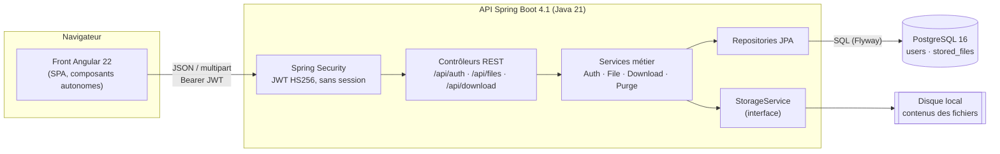
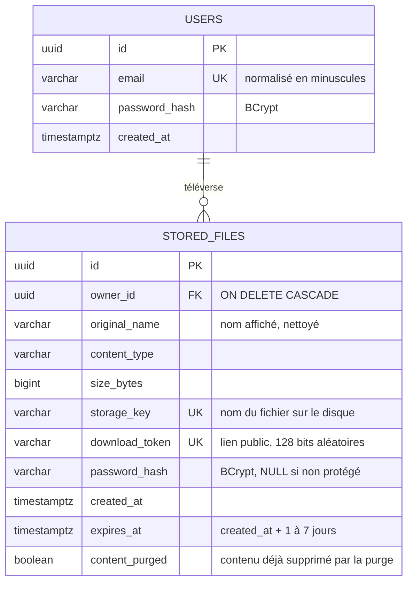
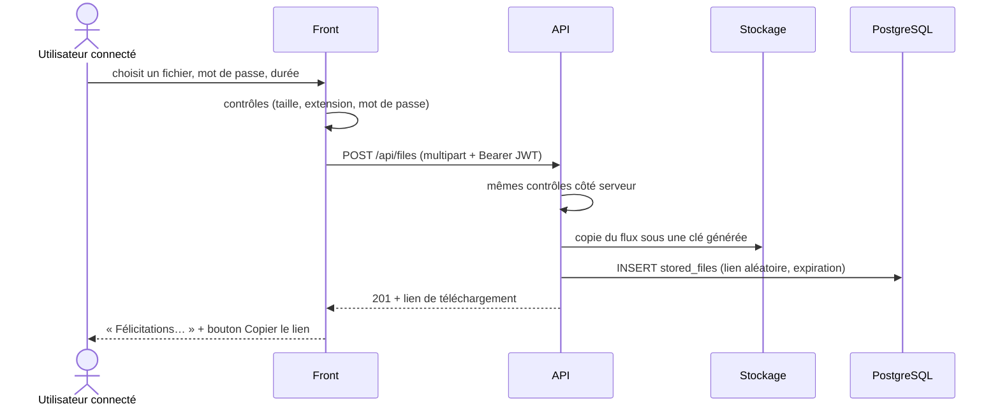
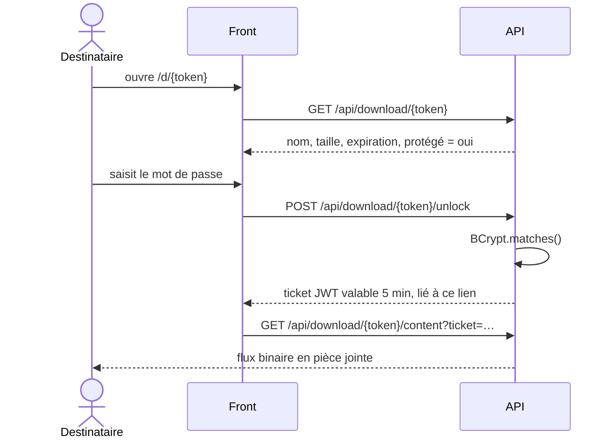

# Architecture de DataShare

## Vue d'ensemble

DataShare est découpé en trois blocs indépendants qui communiquent uniquement par HTTP et SQL.



| Bloc | Rôle | Technologies |
|---|---|---|
| Front | Écrans des maquettes, contrôles de saisie, appel de l'API | Angular 22, TypeScript strict, Reactive Forms, signals |
| API | Règles métier, sécurité, stockage | Spring Boot 4.1, Spring Security (resource server JWT), Spring Data JPA, Flyway |
| Données | Comptes et métadonnées des fichiers | PostgreSQL 16 |
| Contenus | Octets des fichiers téléversés | Système de fichiers local, derrière l'interface `StorageService` (remplaçable par S3) |

## Organisation du code de l'API

Le code est rangé par fonctionnalité plutôt que par couche technique : tout ce qui concerne le téléchargement public est dans `download/`, tout ce qui concerne l'espace personnel dans `file/`.

```
backend/src/main/java/fr/datashare/
├── auth/       US03, US04 : inscription, connexion, utilisateur courant
├── file/       US01, US05, US06 : téléversement, historique, suppression
├── download/   US02 : métadonnées, déverrouillage par mot de passe, flux de téléchargement
├── purge/      Tâche planifiée de suppression des fichiers expirés
├── storage/    Interface StorageService + implémentation disque local
├── security/   Configuration Spring Security, émission et vérification des JWT
├── user/       Entité User et son repository
├── common/     Gestion centralisée des erreurs, générateur de liens
└── config/     Propriétés applicatives, horloge, OpenAPI
```

## Organisation du front

```
frontend/src/app/
├── core/       Services HTTP, session, intercepteur JWT, gardes de routes, fonctions de formatage
├── layout/     Cadre dégradé commun (logo, bouton de compte, pied de page)
├── shared/     Composant d'icônes
└── pages/      home (téléversement), login, register, my-files, download, not-found
```

Chaque page est chargée à la demande (lazy loading) : un visiteur qui ouvre un lien de téléchargement ne télécharge pas le code de l'espace personnel.

## Modèle de données



Index :
- `(owner_id, created_at DESC)` pour l'historique d'un utilisateur, trié du plus récent au plus ancien ;
- `expires_at` pour la tâche de purge ;
- contraintes d'unicité sur `email`, `download_token` et `storage_key`.

Le script de création est `backend/src/main/resources/db/migration/V1__init_schema.sql`. Flyway l'applique au démarrage et garde l'historique des migrations : une évolution du schéma se fait en ajoutant `V2__…sql`, jamais en modifiant `V1`.

## Principaux flux

### Téléversement (US01)



### Téléchargement d'un fichier protégé (US02)



Le ticket évite deux écueils : mettre le mot de passe dans l'URL (il finirait dans les journaux et l'historique du navigateur), ou charger le fichier en JavaScript pour pouvoir l'envoyer en POST (impossible pour 1 Go). Le navigateur télécharge directement le flux.

### Expiration

1. Dès l'échéance, l'API refuse le lien (contrôle de `expires_at` à chaque requête) et répond `410 Gone`.
2. Chaque nuit, `ExpiredFilesPurgeJob` supprime le contenu des fichiers expirés du disque.
3. Les métadonnées restent visibles 30 jours dans l'onglet « Expiré » de l'historique (comme dans les maquettes), puis sont supprimées.

## Endpoints

La documentation complète est générée à partir du code : `docs/openapi.json`, et l'interface Swagger est disponible sur http://localhost:8080/api/docs/ui quand l'API tourne.

| Méthode | Chemin | Accès | Rôle | US |
|---|---|---|---|---|
| POST | `/api/auth/register` | public | Créer un compte | US03 |
| POST | `/api/auth/login` | public | Obtenir un jeton JWT | US04 |
| GET | `/api/auth/me` | connecté | Utilisateur courant | US04 |
| POST | `/api/files` | connecté | Téléverser (multipart : `file`, `password`, `expirationDays`) | US01 |
| GET | `/api/files?status=ALL\|ACTIVE\|EXPIRED` | connecté | Historique | US05 |
| DELETE | `/api/files/{id}` | propriétaire | Supprimer définitivement | US06 |
| GET | `/api/download/{token}` | public | Métadonnées avant téléchargement | US02 |
| POST | `/api/download/{token}/unlock` | public | Vérifier le mot de passe, obtenir un ticket | US02 |
| GET | `/api/download/{token}/content` | public (+ ticket si protégé) | Flux du fichier | US02 |

Toutes les erreurs suivent le format Problem Details (RFC 9457) avec un champ `code` stable que le front peut tester :

```json
{
  "type": "https://datashare.fr/errors/file-expired",
  "title": "Gone",
  "status": 410,
  "detail": "Ce fichier n'est plus disponible en téléchargement car il a expiré.",
  "code": "FILE_EXPIRED"
}
```
